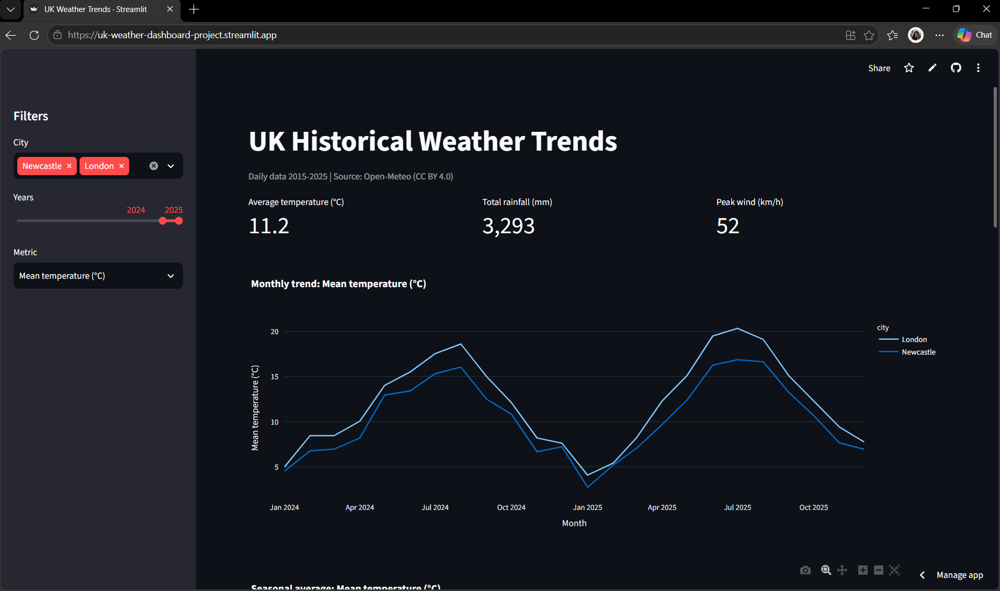

# UK Historical Weather Trends Dashboard

An interactive Streamlit dashboard exploring 11 years of daily weather across five UK cities, built on an automated pipeline from API extraction to a cloud-hosted app.

**Live app:** [[streamlit.app](https://uk-weather-dashboard-project.streamlit.app/)]



## Problem
Weather and climate data is often shared as static spreadsheets and reports. This project replaces that with a reproducible Python pipeline and a dashboard anyone can explore.

## Features
- Filter by city, year range and metric (temperature, rainfall, wind)
- Monthly trends, seasonal comparison and year × month heatmap
- Anomaly view: each year against the 2015-2025 average
- Extreme day counts with adjustable thresholds
- Warming trend per decade for each city
- Daily view with comparison to the usual weather for that date
- Download the filtered data as CSV

## Architecture
```
Open-Meteo API -> src/fetch.py -> data/raw -> src/clean.py -> data/clean/weather_clean.csv -> app.py (Streamlit)
```

## Data
- **Source:** [Open-Meteo Historical Weather API](https://open-meteo.com/) (CC BY 4.0)
- **Cities:** Newcastle, Middlesbrough, Sunderland, London, Manchester
- **Period:** 1 Jan 2015 to 31 Dec 2025
- **Size:** 20,090 daily rows (4,018 days per city)
- **Variables:** max, min and mean temperature (°C), rainfall (mm), max wind speed (km/h)

## Data cleaning
Full detail in [docs/data_cleaning_notes.md](docs/data_cleaning_notes.md). Summary:
- Checked for missing values, duplicate city-date pairs and impossible readings: none found
- Renamed columns to include units
- Added year, month and meteorological season fields

## Run locally
```bash
git clone https://github.com/IBakare/uk-weather-dashboard.git
cd uk-weather-dashboard
python -m venv .venv
.venv\Scripts\activate        # Mac/Linux: source .venv/bin/activate
pip install -r requirements.txt
python src/fetch.py           # download raw data
python src/clean.py           # create cleaned CSV
streamlit run app.py
```

## Key insights
- **Manchester is the wettest city in every season**, peaking in autumn at about 4.8 mm of rain per day, while spring is the driest season across all five cities (roughly 0.7 to 1.2 mm per day).
- **In 2025, London recorded 38 days above 25 °C**, nearly three times Manchester (15) and well ahead of Middlesbrough (13), Newcastle (10) and Sunderland (5). Manchester also had the most days above 10 mm of rain (28).
- **The 19 July 2022 heatwave pushed every city 8 to 9 °C above its usual mean temperature for that date.** London peaked at 38.0 °C, and even Newcastle reached 35.1 °C.


## Limitations
- Data is modelled reanalysis at a grid point, not physical station readings
- Eleven years is too short to draw climate conclusions; trends are indicative only

## Tech stack
Python, Pandas, NumPy, Plotly, Streamlit, Requests

## Author
Ifeloluwa Bakare | [[LinkedIn](https://www.linkedin.com/in/ifeloluwabakare/)]
